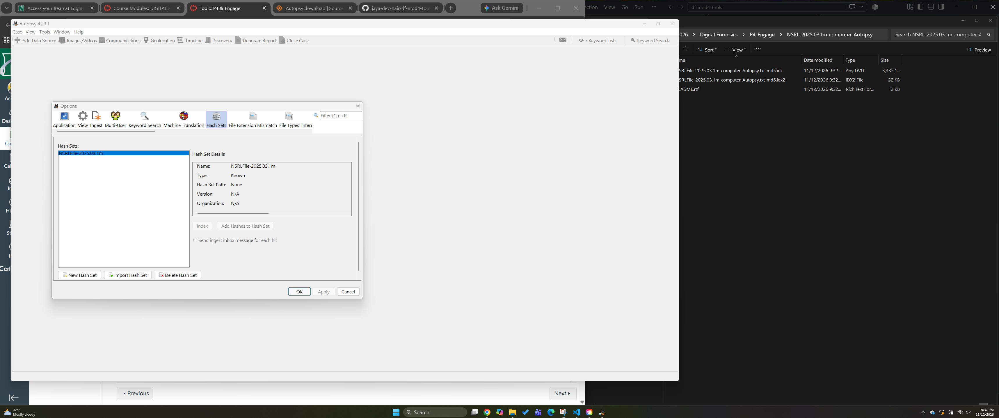
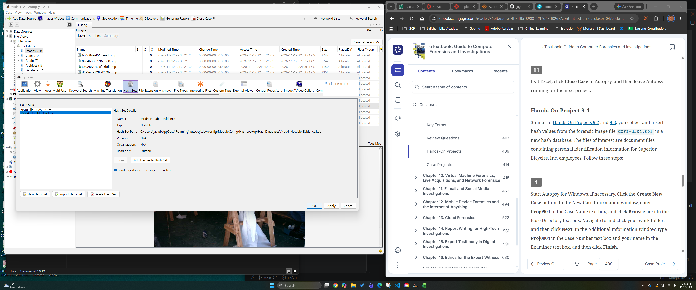
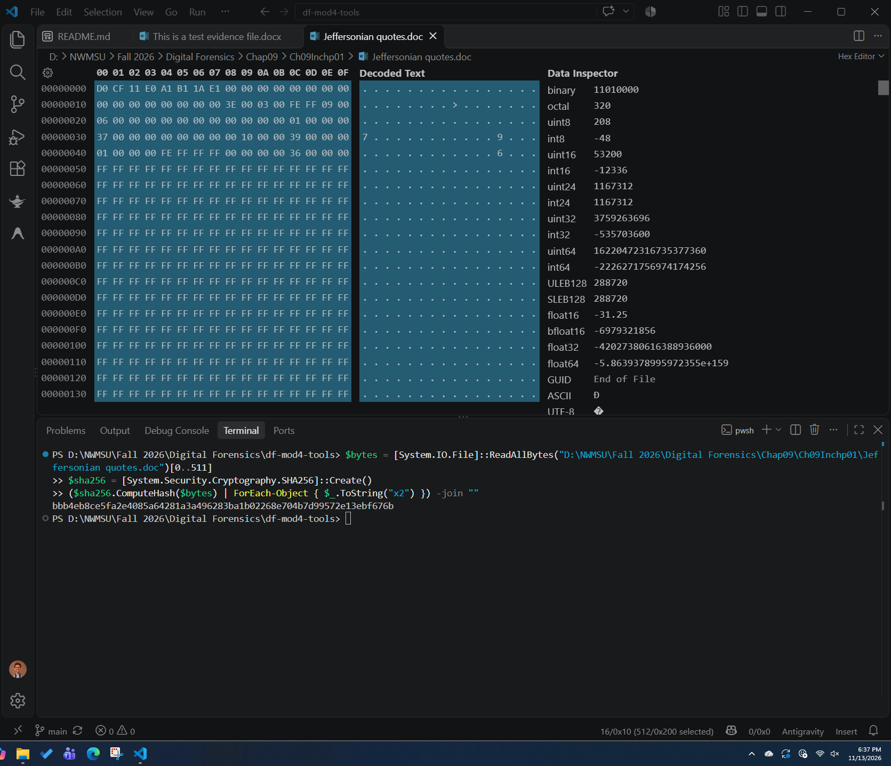

# df-mod4-tools: Digital Forensics Module 4 Project

This project explores core digital forensics techniques, including hashing, evidence tagging, hex sector analysis, and simple encryption. The exercises demonstrate how these methods help identify, organize, examine, and protect digital evidence.

## Exercise 1: Autopsy - Import Hash Database (Known Files)

- Verification screenshot: 
- Write-up notes: Explain why importing a known-file hash database is useful in digital forensics.

## Exercise 2: Autopsy - Create Hash Database (Evidence Files)

- Verification screenshot: 
- Write-up notes: Explain why creating a hash database for evidence files is useful in digital forensics.

## Exercise 3: Hex Editor - Match File Remnants

- Verification screenshot: 
- Write-up notes: Explain why matching file remnants in a hex editor is useful in digital forensics.

## Exercise 4: Simple Encryption

- Verification screenshot: 
- Write-up notes: Explain why understanding simple encryption is useful in digital forensics.

## Optional Bonus: Crack a Passcode with a Rainbow Table

- Verification screenshot: 
- Write-up notes: Explain why rainbow tables are useful to understand in digital forensics.
